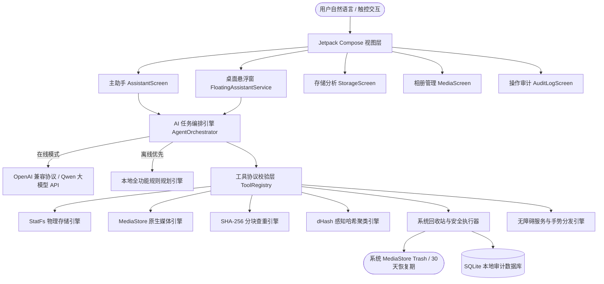

# Android AI 文件与相册管理助手 (AIAgentOfAndroid)

[-3DDC84?logo=android&logoColor=white)](https://developer.android.com)
[](https://kotlinlang.org)
[](https://developer.android.com/jetpack/compose)
[](#-release-apk-下载与构建)
[](LICENSE)

面向普通真实用户设备的 **Android AI 智能文件、相册与屏幕管理助手**。本项目结合 Android 官方原生媒体 API、可插拔云端/离线大模型规划引擎、连点器级屏幕辅助手势操作，以及全新四态防遮挡灵动桌面悬浮窗，打造真实数据闭环、绝对隐私安全、可撤销恢复的高可靠手机智能体。

---

## 🌟 核心特色与五大能力矩阵

### 1. 🛡️ 隐私离线优先与“防 Token 爆炸”防护体系
- **零视觉模型开销**：传统智能体每步截全屏上传多模态大模型，消耗巨额 Token 且极易泄露私人照片；本项目采用端侧无障碍微秒级结构化提取，回传纯文本摘要，**彻底阻断 Token 爆炸**；
- **纯本地查重与聚类**：相册扫描、64KB 分块 SHA-256 精确比对、64-bit 差异感知哈希 (`dHash`) 相似照片识别全部在设备端离线运行；
- **按需单查协议 (`query_file_detail`)**：媒体列表回传仅包含极简 ID 与大小摘要，仅在用户指明要看某具体文件时才调取单条详情。

### 2. ⚡ 毫秒级屏幕连点器与手势操作 (`Accessibility & Gesture`)
- **连点器级响应**：基于 Android 系统 `dispatchGesture` API，构造持续仅 50 毫秒的高精度原生触控手势，无需外部 adb 进程，点击与滑动即刻生效；
- **原生节点穿透**：优先调用系统无障碍节点 `ACTION_CLICK`，未声明点击事件的自定义控件自动回退至物理中心坐标手势点击；
- **全局系统控制**：支持系统返回 (`BACK`)、回到桌面 (`HOME`)、多任务 (`RECENTS`)、通知栏展开等全局操作。

### 3. 🎈 全新四态灵动悬浮窗（零遮挡、随时唤出）
- **贴边极窄把手态 (`DOCKED_TAB`)**：收起后仅在屏幕边缘占 14dp 宽度的半透明磨砂拉手，贴靠在黑边旁，**主屏幕正文与游戏完全零遮挡**；轻触边缘拉手瞬时唤出；
- **展开对话态 (`EXPANDED`)**：52% 黄金半屏高度、88% 宽度（最大 400dp），22dp 毛玻璃圆角卡片，留出上下大面积可视空间；
- **点击窗外自动贴边**：在对话卡片外任意区域轻触（`ACTION_OUTSIDE`），自动平滑收纳至侧边；
- **系统通知栏随时唤出**：状态栏常驻卡片集成【✨ 唤出助手】、【📌 贴边收纳】、【👁️ 完全隐身】及【✕ 关闭】按钮，任意场景随时唤出。

### 4. 📂 真实底层存储与媒体管理
- **底层 StatFs 物理测算**：直接读取手机闪存真实已用/可用容量，分项解析视频、图片、音频、文档、APK 与系统占用；
- **大文件与旧安装包筛查**：快速筛选超过 500MB 的冗余视频与残留 `.apk`；
- **重复照片去重建议**：精准比对相同图片副本，自动提议保留一份、其余移入回收站。

### 5. 🔒 系统级回收站与审计可恢复闭环
- **安全第一**：严禁静默永久删除！所有清理任务统一封装为 `ActionPlan` 操作卡片，明确列出目标清单、路径与释放容量；
- **系统级确认弹窗**：通过 `MediaStore.createTrashRequest` 调起原生系统回收站确认弹窗，30 天保留期内随时可反向还原；
- **本地审计日志**：基于 SQLite 留存所有操作记录与 JSON 目标快照，支持从记录列表一键请求还原。

---

## 🏗️ 系统架构图



---

## 📦 Release APK 下载与构建

本工程已配置正式签名，可直接构建并安装运行在 Android 11 ~ 16 设备上。

### 方式 1：本地快速构建 Release APK
```powershell
# 1. 运行本地单元测试
.\gradlew.bat testDebugUnitTest

# 2. 构建正式 Release APK
.\gradlew.bat assembleRelease
```
构建产物位于：
`app/build/outputs/apk/release/app-release.apk`

> **签名说明**：`release.keystore` 不随仓库分发。本机缺少该密钥库时，`assembleRelease` 仍会成功但产出**未签名** APK；
> 可通过环境变量 `AIAGENT_STORE_PASSWORD` / `AIAGENT_KEY_ALIAS` / `AIAGENT_KEY_PASSWORD`（或 Gradle 属性
> `aiagent.storePassword` 等）提供签名口令，避免把密码写死在构建脚本中。

### 方式 2：真机一键安装
```powershell
adb push app\build\outputs\apk\release\app-release.apk /data/local/tmp/app.apk
adb shell pm install -r -t -g /data/local/tmp/app.apk
adb shell am start -n com.aiagent.android/com.aiagent.android.ui.MainActivity
```

---

## 📑 完整工程文档索引

项目遵循严苛的多 Agent 协作与工程规约，完整文档见 [docs/](file:///d:/Project/AIAgentOfAndriod/docs)：

- [AGENTS.md](file:///d:/Project/AIAgentOfAndriod/AGENTS.md)：协作守则、真实性第一原则与交接规范
- [docs/README.md](file:///d:/Project/AIAgentOfAndriod/docs/README.md)：文档导航与系统总览
- [docs/HANDOFF.md](file:///d:/Project/AIAgentOfAndriod/docs/HANDOFF.md)：当前研发阶段、三态清单与待办事项
- [docs/PRODUCT.md](file:///d:/Project/AIAgentOfAndriod/docs/PRODUCT.md)：产品功能定义与交付边界
- [docs/ARCHITECTURE.md](file:///d:/Project/AIAgentOfAndriod/docs/ARCHITECTURE.md)：分层架构、安全卡片与加密设计
- [docs/CHANGELOG.md](file:///d:/Project/AIAgentOfAndriod/docs/CHANGELOG.md)：历史版本演进日志 (Asia/Shanghai)

---

## 📄 开源协议

本项目采用 [Apache License 2.0](LICENSE) 协议开源。
