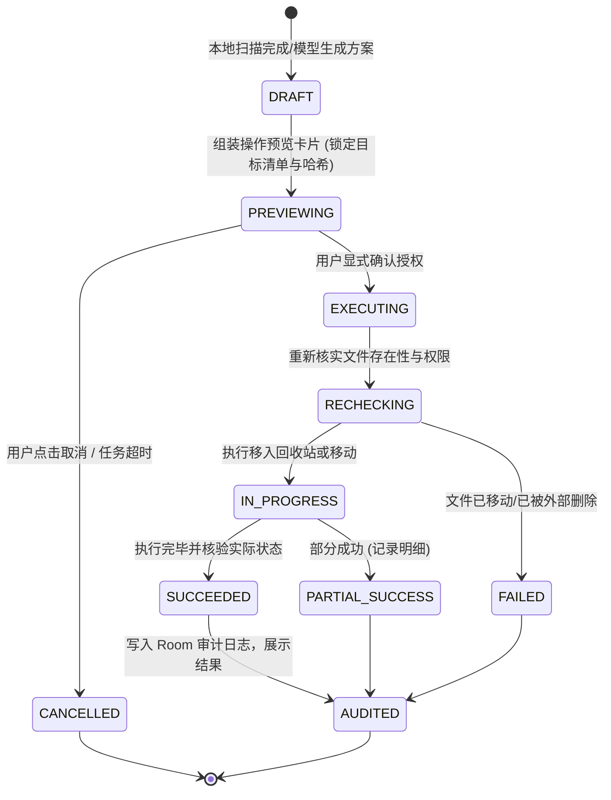

# 系统架构与技术实现说明书 (ARCHITECTURE.md)

---

## 1. 整体架构与分层设计

本项目严格遵循清晰的原生 Android 架构规范，自顶向下划分为四层：

```mermaid
graph TD
    subgraph Layer1 [1. 界面与交互层 (UI & Presentation)]
        AssistantScreen[AI 助手屏幕 (对话/步骤/确认卡片)]
        StorageScreen[存储分析屏幕 (概览/大文件/重复文件)]
        MediaFileScreen[文件与相册屏幕 (网格/筛选/预览/多选)]
        AuditLogScreen[操作记录屏幕 (审计明细/恢复入口)]
        SettingsScreen[设置屏幕 (模型配置/权限/无障碍开关)]
    end

    subgraph Layer2 [2. 任务编排与状态层 (Orchestration & State)]
        TaskOrchestrator[任务编排器 (TaskOrchestrator)]
        LLMPlanner[模型规划与结构化工具驱动 (ModelPlanner)]
        LocalRuleFallback[离线规则备选编排器 (LocalRuleFallback)]
        ActionDispatcher[操作预审与执行派发器 (ActionDispatcher)]
    end

    subgraph Layer3 [3. 可校验工具层 (Verifiable Tools & Executors)]
        MediaTool[媒体库工具 (MediaStore / Trash API)]
        FileTool[文件系统与 SAF 工具 (SAF / Hash 计算)]
        StorageTool[存储空间统计工具 (StatFs / 分类聚合)]
        ScreenTool[受限屏幕执行器 (AccessibilityService / 视觉辅助)]
    end

    subgraph Layer4 [4. 数据访问与底层适配 (Data & Infrastructure)]
        RoomDB[(Room 数据库: 索引/任务状态/审计日志)]
        KeyStoreVault[Android KeyStore 加密存储 (AES-GCM)]
        OpenAIAdapter[模型 HTTP 适配器 (可替换服务商/连接测试)]
        AndroidFramework[Android 11-16 基础接口与权限机制]
    end

    Layer1 --> Layer2
    Layer2 --> Layer3
    Layer3 --> Layer4
    Layer2 --> Layer4
```

---

## 2. 核心分层职责说明

### 2.1 界面与交互层 (Presentation Layer)
- **技术栈**：Jetpack Compose、Material 3、Compose Navigation、StateFlow。
- **设计要点**：
  - 纯声明式 UI，状态驱动单向数据流（UDF）。
  - 统一深色模式支持与现代中文字体排版。
  - 任务闭环状态呈现：区分【正在检索】、【生成方案】、【等待用户确认】、【执行中】、【校验结果】。
  - 所有耗时操作带有取消按钮与真实的百分比/文件计数进度条。

### 2.2 任务编排与状态层 (Orchestration & State Management)
- **核心组件**：
  - `TaskOrchestrator`：负责接收用户自然语言指令或本地 UI 点击，调度 LLM 或本地策略进行多步规划。
  - `ModelPlanner`：负责根据上下文拼装工具声明（Tools Schema），向已配置的大模型发起结构化请求。
  - `ActionPlanCard`：在执行破坏性操作前，冻结当前拟操作的对象列表（URI/ID、路径、大小、操作类型），向用户渲染确认卡片。
- **状态安全铁律**：
  - 严禁执行模型凭空捏造的虚假路径；所有执行目标必须经过本地已扫描对象的唯一真实引用（MediaStore ID 或 DocumentUri）校验。
  - 任务设置步数上限（默认 $\le 8$ 步）、重试次数上限（$\le 2$ 次）及超时中断机制。

### 2.3 可校验工具层 (Verifiable Tools & Executors)
提供明确的结构化输入与输出，杜绝黑盒执行：
1. **`MediaTool`**：
   - 基于 `android.provider.MediaStore` 检索图片、视频与音频。
   - 使用分页查询（`ContentResolver.query` 带 `Bundle.EXTRA_QUERY_ARG_OFFSET`），避免大相册 OOM。
   - **回收站机制**：针对 Android 11+ (API 30+)，调用 `MediaStore.createTrashRequest(cr, uris, true)` 移入系统媒体回收站，优先保留 30 天恢复窗口。
2. **`FileTool`**：
   - 适配 Storage Access Framework (SAF) 与常规文件访问。
   - 完全重复检测算法：先根据文件字节大小（`length`）进行 $O(1)$ 分组，仅对同大小的候选文件使用流式 SHA-256 分块哈希计算，防内存溢出并支持实时中断。
3. **`StorageTool`**：
   - 通过 `StatFs` 获取系统及外部存储的真实总容量、可用容量与已用容量。
   - 聚合计算各类文件的真实物理占用（图片/视频/音频/文档/安装包/其他）。
4. **`ScreenActionExecutor` (`ScreenAssistantAccessibilityService`)**：
   - 独立的 `AccessibilityService` 模块，配置 `canPerformGestures="true"` 与 `canRetrieveWindowContent="true"`。
   - 支持文字节点智能点击（优先调用节点 `ACTION_CLICK`，失败时自动下沉为其屏幕中心坐标执行连点手势）。
   - 支持连点器手势模式：基于 `dispatchGesture` 模拟毫秒级单点点击 (`clickAt(x, y)`) 与平滑方向滑动 (`swipeDirection(direction)`)。
   - 支持全局系统动作派发：返回 (`BACK`)、回到桌面 (`HOME`)、多任务列表 (`RECENTS`)、通知栏 (`NOTIFICATIONS`)。
   - 提供轻量纯文本屏幕提取 (`inspect_current_screen`)：以纯文本形式提取可见可交互元素与中心坐标，杜绝截屏传输，极大节省 Token 开销。
   - 安全铁律约束：坚决拦截针对系统级删除/清空/格式化等破坏性弹窗的自动代点。
5. **Token 经济与隐私保护协议 (Token Economy & Privacy Protocol)**：
   - 严禁向模型回传海量相册列表或原始图片 Base64/二进制数据。
   - 全盘扫描、流式哈希与相似度聚合完全在端侧本地离线完成，回传大模型的数据严格保持轻量紧凑（数量封顶并剔除无用冗余字段）。
   - 提供精准的单文件详细元数据查询工具 (`query_file_detail`)，仅在用户明确需要了解某一特定文件时单次按需调取。

### 2.4 数据访问与底层适配层 (Data & Adapters)
1. **Room 本地持久化**：
   - `MediaIndexEntity`：本地媒体与文件缓存索引，加速即时搜索与查重。
   - `TaskStateEntity`：记录多步任务的持久化状态，支持应用异常退出后状态恢复。
   - `AuditLogEntity`：操作记录，记录操作时间、操作类型、影响文件明细、预计释放大小、执行状态（成功/失败/已恢复）。
2. **安全密钥保护 (`KeyStoreVault`)**：
   - 用户填写的自定义模型 API Key，必须使用基于 Android KeyStore 硬件后端的 AES-256-GCM 算法进行加解密。
   - 严禁将明文密钥写入源码、SharedPreferences、普通文件、日志或 Git 仓库。
3. **模型网络适配层 (`OpenAIAdapter`)**：
   - 基于 OkHttp 3 / 4 实现标准 OpenAI-compatible Tool Calling 协议。
   - 支持自定义 `base_url`（如接入 DeepSeek、通义千问、MiniMax、智谱 GLM 或官方 OpenAI 兼容网关）。
   - 提供连接测试（Ping / Check Connection）、超时控制（默认 30s）与流式中断。

---

## 3. 权限模型与 Android 11~16 适配策略

| 权限名称 | 适用版本 | 用途 | 降级与处理机制 |
| :--- | :--- | :--- | :--- |
| `READ_MEDIA_IMAGES` / `READ_MEDIA_VIDEO` / `READ_MEDIA_AUDIO` | Android 13+ (API 33+) | 读取相册图片、视频与音频 | 动态申请，未授权时提示用户媒体管理不可用 |
| `READ_MEDIA_VISUAL_USER_SELECTED` | Android 14+ (API 34+) | 用户在系统权限弹窗中选择“部分照片” | 检测到部分授权时，界面明确标注“当前为受限访问范围”，并提供重新扩选入口 |
| `READ_EXTERNAL_STORAGE` / `WRITE_EXTERNAL_STORAGE` | Android 11~12 (API 30~32) | 旧版媒体与文件访问 | 仅在 API $\le 32$ 时请求 |
| `ACTION_OPEN_DOCUMENT_TREE` (SAF) | 全版本通用 | 访问用户指定的具体文件夹（如 Download、Documents） | 无需高危系统权限，通过系统文件选择器由用户显式授予目录读写权限 |
| `MANAGE_EXTERNAL_STORAGE` | Android 11+ (API 30+) | 深度分析非媒体目录与 APK 文件 | **可选核心权限**。不强制弹窗，用户点击“深度全盘分析”时弹出专属说明页再跳转系统设置授权 |
| `BIND_ACCESSIBILITY_SERVICE` | 全版本通用 | 辅助屏幕导航与定位 | **独立辅助模块**。默认关闭，用户手动在系统辅助功能中开启，应用内实时监听状态 |

---

## 4. 关键交互流程与状态机

### 4.1 操作计划确认状态机 (ActionPlan State Machine)



---

## 5. 依赖库版本选型与兼容性

- **Compile SDK / Target SDK**：36 (Android 16, 支持最新平台行为)
- **Min SDK**：30 (Android 11, 确保 MediaStore Trash 与 Scoped Storage 基础可用)
- **Build Tools**：36.0.0
- **Gradle**：9.5.0
- **Android Gradle Plugin (AGP)**：9.3.1
- **Kotlin**：2.2.10 / 2.3.20 (配合 Kotlin Compose Compiler)
- **Jetpack Compose BOM**：2026.02.01 (提供 Material 3、Navigation Compose、Icons Extended)
- **Room**：2.6.1 / 2.7.0-alpha
- **Coroutines & Flow**：1.10.x
- **OkHttp**：4.12.0 (网络通信与 LLM API 交互)
- **Security Crypto**：`androidx.security:security-crypto:1.1.0-alpha06` 或原生 KeyStore 封装
