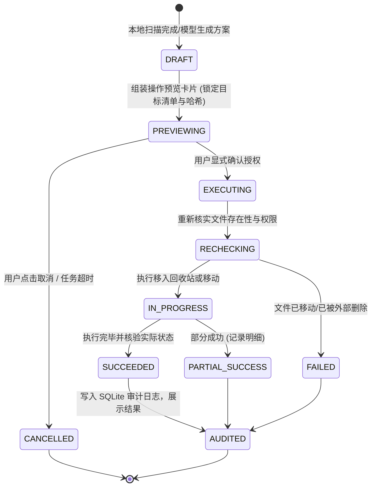

# 系统架构与技术实现说明书 (ARCHITECTURE.md)

---

## 1. 整体架构与分层设计

本项目严格遵循清晰的原生 Android 架构规范，自顶向下划分为四层：

```mermaid
graph TD
    subgraph Layer1 [1. 界面与交互层 (UI & Presentation)]
        AssistantScreen[AI 助手屏幕 (对话/步骤/确认卡片)]
        StorageScreen[存储分析屏幕 (概览/大文件/重复文件)]
        MediaFileScreen[文件与相册屏幕 (网格/筛选/预览/多选)]
        AuditLogScreen[操作记录屏幕 (审计明细/恢复入口)]
        SettingsScreen[设置屏幕 (模型配置/权限/无障碍开关)]
    end

    subgraph Layer2 [2. 任务编排与状态层 (Orchestration & State)]
        TaskOrchestrator[任务编排器 (TaskOrchestrator)]
        LLMPlanner[模型规划与结构化工具驱动 (ModelPlanner)]
        LocalRuleFallback[离线规则备选编排器 (LocalRuleFallback)]
        ActionDispatcher[操作预审与执行派发器 (ActionDispatcher)]
    end

    subgraph Layer3 [3. 可校验工具层 (Verifiable Tools & Executors)]
        MediaTool[媒体库工具 (MediaStore / Trash API)]
        FileTool[文件系统与 SAF 工具 (SAF / Hash 计算)]
        StorageTool[存储空间统计工具 (StatFs / 分类聚合)]
        ScreenTool[受限屏幕执行器 (AccessibilityService / 视觉辅助)]
    end

    subgraph Layer4 [4. 数据访问与底层适配 (Data & Infrastructure)]
        RoomDB[(SQLiteOpenHelper: 媒体缓存/审计日志)]
        KeyStoreVault[Android KeyStore 加密存储 (AES-GCM)]
        OpenAIAdapter[模型 HTTP 适配器 (可替换服务商/连接测试)]
        AndroidFramework[Android 11-16 基础接口与权限机制]
    end

    Layer1 --> Layer2
    Layer2 --> Layer3
    Layer3 --> Layer4
    Layer2 --> Layer4
```

---

## 2. 核心分层职责说明

### 2.1 界面与交互层 (Presentation Layer)
- **技术栈**：Jetpack Compose、Material 3、Compose Navigation、StateFlow。
- **设计要点**：
  - 纯声明式 UI，状态驱动单向数据流（UDF）。
  - 统一深色模式支持与现代中文字体排版。
  - 任务闭环状态呈现：区分【正在检索】、【生成方案】、【等待用户确认】、【执行中】、【校验结果】。
  - 当前提供任务停止按钮和真实工具步骤；尚未实现文件级百分比进度，不能显示假进度。
- **桌面全局悬浮窗架构 (`FloatingAssistantService` & `FloatingAssistantManager`)**：
  - 基于 Android `WindowManager`（`TYPE_APPLICATION_OVERLAY`）与 `SYSTEM_ALERT_WINDOW` 权限，支持跨任意第三方应用与手机桌面随时调出；
  - 服务以 `startForeground` 前台化（`FOREGROUND_SERVICE_SPECIAL_USE`），并为通知申请 `POST_NOTIFICATIONS` 运行时权限，保证 Android 13+ 上“通知栏随时唤出”可靠可用；
  - `FloatingAssistantService` 声明为 `exported=false`，仅允许本应用（含本应用创建的 PendingIntent）启动，收敛外部攻击面；
  - 采用自定义 `FloatingLifecycleOwner`（集成 `LifecycleRegistry`、`ViewModelStore` 与 `SavedStateRegistryController`），让全功能 Jetpack Compose 可以在后台 Service 中稳定无缝运行；
  - **双态自适应切换**：
    1. **折叠态（悬浮球）**：采用 `FLAG_NOT_FOCUSABLE`，支持全屏边缘拖拽与吸附，不干扰下层应用触摸；点击立刻平滑展开；
    2. **展开态（悬浮对话窗）**：采用 `FLAG_NOT_TOUCH_MODAL` 与 `SOFT_INPUT_ADJUST_RESIZE`，可呼出系统输入法键盘输入指令，支持快捷动作 Chips、实时任务步数卡片与操作确认预览卡片；点击悬浮窗外部区域（`ACTION_OUTSIDE`）自动缩回悬浮球。

### 2.2 任务编排与状态层 (Orchestration & State Management)
- **核心组件**：
  - `TaskOrchestrator`：负责接收用户自然语言指令或本地 UI 点击，调度 LLM 或本地策略进行多步规划。
  - `ModelPlanner`：负责根据上下文拼装工具声明（Tools Schema），向已配置的大模型发起结构化请求。
  - `ActionPlanCard`：在执行破坏性操作前，冻结当前拟操作的对象列表（URI/ID、路径、大小、操作类型），向用户渲染确认卡片。
- **状态安全铁律**：
  - 严禁执行模型凭空捏造的虚假路径；所有执行目标必须经过本地已扫描对象的唯一真实引用（MediaStore ID 或 DocumentUri）校验。
  - 任务设置步数上限（当前实现：`AgentLoop` 最多 24 轮、48 次工具调用，外层超时 5 分钟，见 §7）、重试次数上限（规划目标 ≤ 2 次，尚未单独实现）及超时中断机制（OkHttp 连接/读取超时）。

### 2.3 可校验工具层 (Verifiable Tools & Executors)
提供明确的结构化输入与输出，杜绝黑盒执行：
1. **`MediaTool`**：
   - 基于 `android.provider.MediaStore` 检索图片、视频与音频。
   - 使用分页查询（`ContentResolver.query` 带 `Bundle.EXTRA_QUERY_ARG_OFFSET`），避免大相册 OOM。
   - **回收站机制**：针对 Android 11+ (API 30+)，调用 `MediaStore.createTrashRequest(cr, uris, true)` 移入系统媒体回收站，优先保留 30 天恢复窗口。
2. **`FileTool`**：
   - 适配 Storage Access Framework (SAF) 与常规文件访问。
   - 完全重复检测算法：先根据文件字节大小（`length`）进行 $O(1)$ 分组，仅对同大小的候选文件使用流式 SHA-256 分块哈希计算，防内存溢出并支持实时中断。
3. **`StorageTool`**：
   - 通过 `StatFs` 获取系统及外部存储的真实总容量、可用容量与已用容量。
   - 聚合计算各类文件的真实物理占用（图片/视频/音频/文档/安装包/其他）。
4. **`ScreenActionExecutor` (`ScreenAssistantAccessibilityService`)**：
   - 独立的 `AccessibilityService` 模块，配置 `canPerformGestures="true"` 与 `canRetrieveWindowContent="true"`。
   - 支持文字节点智能点击（优先调用节点 `ACTION_CLICK`，失败时自动下沉为其屏幕中心坐标执行连点手势）。
   - 支持连点器手势模式：基于 `dispatchGesture` 模拟毫秒级单点点击 (`clickAt(x, y)`) 与平滑方向滑动 (`swipeDirection(direction)`)。
   - 支持全局系统动作派发：返回 (`BACK`)、回到桌面 (`HOME`)、多任务列表 (`RECENTS`)、通知栏 (`NOTIFICATIONS`)。
   - 提供轻量纯文本屏幕提取 (`inspect_current_screen`)：以纯文本形式提取可见可交互元素与中心坐标，杜绝截屏传输，极大节省 Token 开销。
   - 安全铁律约束：坚决拦截针对系统级删除/清空/格式化等破坏性弹窗的自动代点。当前实现通过 `isDestructiveSystemDialogActive()` 检测“系统包 + 破坏性文案”并同时拦截文字点击与坐标点击；仅在本应用自身界面才放行，避免误伤第三方应用。
5. **Token 经济与隐私保护协议 (Token Economy & Privacy Protocol)**：
   - 严禁向模型回传海量相册列表或原始图片 Base64/二进制数据。
   - 全盘扫描、流式哈希与相似度聚合完全在端侧本地离线完成，回传大模型的数据严格保持轻量紧凑（数量封顶并剔除无用冗余字段）。
   - 提供精准的单文件详细元数据查询工具 (`query_file_detail`)，仅在用户明确需要了解某一特定文件时单次按需调取。

### 2.4 数据访问与底层适配层 (Data & Adapters)
1. **本地持久化（当前实现：SQLiteOpenHelper；Room 为后续规划）**：
   - 当前 `AppDatabaseHelper` 使用原生 `SQLiteOpenHelper` 维护 `audit_records` 与 `media_cache` 两张表，并未引入 Room；
   - 规划中的 Room 实体（`MediaIndexEntity` / `TaskStateEntity` / `AuditLogEntity`）尚未落地，本节旧描述已按实际实现校正。
2. **安全密钥保护 (`KeyStoreVault`)**：
   - 用户填写的自定义模型 API Key，必须使用基于 Android KeyStore 硬件后端的 AES-256-GCM 算法进行加解密。
   - 严禁将明文密钥写入源码、SharedPreferences、普通文件、日志或 Git 仓库。
3. **模型网络适配层 (`OpenAIAdapter`)**：
   - 基于 OkHttp 3 / 4 实现标准 OpenAI-compatible Tool Calling 协议。
   - 支持自定义 `base_url`（如接入 DeepSeek、通义千问、MiniMax、智谱 GLM 或官方 OpenAI 兼容网关）。
   - 提供连接测试（Ping / Check Connection）、超时控制（默认 30s）与流式中断。

---

## 3. 权限模型与 Android 11~16 适配策略

| 权限名称 | 适用版本 | 用途 | 降级与处理机制 |
| :--- | :--- | :--- | :--- |
| `READ_MEDIA_IMAGES` / `READ_MEDIA_VIDEO` / `READ_MEDIA_AUDIO` | Android 13+ (API 33+) | 读取相册图片、视频与音频 | 动态申请，未授权时提示用户媒体管理不可用 |
| `READ_MEDIA_VISUAL_USER_SELECTED` | Android 14+ (API 34+) | 用户在系统权限弹窗中选择“部分照片” | 检测到部分授权时，界面明确标注“当前为受限访问范围”，并提供重新扩选入口 |
| `READ_EXTERNAL_STORAGE` / `WRITE_EXTERNAL_STORAGE` | Android 11~12 (API 30~32) | 旧版媒体与文件访问 | 仅在 API $\le 32$ 时请求 |
| `ACTION_OPEN_DOCUMENT_TREE` (SAF) | 全版本通用 | 访问用户指定的具体文件夹（如 Download、Documents） | 无需高危系统权限，通过系统文件选择器由用户显式授予目录读写权限 |
| `MANAGE_EXTERNAL_STORAGE` | Android 11+ (API 30+) | 深度分析非媒体目录与 APK 文件 | **可选核心权限**。不强制弹窗，用户点击“深度全盘分析”时弹出专属说明页再跳转系统设置授权 |
| `BIND_ACCESSIBILITY_SERVICE` | 全版本通用 | 辅助屏幕导航与定位 | **独立辅助模块**。默认关闭，用户手动在系统辅助功能中开启，应用内实时监听状态 |

---

## 4. 关键交互流程与状态机

### 4.1 操作计划确认状态机 (ActionPlan State Machine)



---

## 5. 依赖库版本选型与兼容性

- **Compile SDK / Target SDK**：36 (Android 16, 支持最新平台行为)
- **Min SDK**：30 (Android 11, 确保 MediaStore Trash 与 Scoped Storage 基础可用)
- **Build Tools**：36.0.0
- **Gradle**：9.5.0
- **Android Gradle Plugin (AGP)**：9.3.1
- **Kotlin**：2.2.10（`gradle/libs.versions.toml`）
- **Jetpack Compose BOM**：2026.02.01（Material 3 + Icons Extended；**未引入 Navigation Compose**）
- **协程**：kotlinx-coroutines 1.9.0
- **OkHttp**：4.12.0 (网络通信与 LLM API 交互)
- **Gson**：2.11.0（工具 Schema / 审计记录序列化）
- **本地存储**：原生 `SQLiteOpenHelper`（**未引入 Room**）
- **安全**：原生 Android KeyStore（AES-256-GCM 封装；**未引入 androidx.security-crypto**）

---

## 6. 实现现状校准与关键决策记录（2026-10-18）

为避免继续把“规划”写成“完成”，本节明确记录当前代码与早期架构草案的差异及本轮决策：

1. **组件命名校准**：实际组件为 `AgentOrchestrator`、`LlmClient`、`ToolRegistry`、`ActionPlan`；
   早期文档中的 `TaskOrchestrator` / `ModelPlanner` / `ActionDispatcher` 为规划名，未作为独立类实现。
2. **本地存储校准**：实际使用 `AppDatabaseHelper`（SQLiteOpenHelper），未引入 Room；
   任务状态未持久化，进程被杀后对话与任务步骤丢失（“开新对话”同样为内存态重置）。
3. **状态管理校准（历史，已被 §7 演进）**：最初由 MainActivity 直接维护组合状态；当前进程内 `AgentConversation` 统一主界面、悬浮窗与就地续聊，会话仍未引入 ViewModel / Navigation Compose，屏幕服务连接状态单独使用 StateFlow。
4. **离线意图分类决策（2026-10-18）**：将离线关键词匹配抽离为 `OfflineIntentClassifier` 纯函数，采用“先具体、后宽泛”的优先级；
   修复“打开桌面悬浮窗 → HOME”“帮我点设置 → 打开存储设置”“打开无障碍设置 → 打开存储设置”“查看当前屏幕不匹配”等回归，并由 `OfflineIntentClassifierTest` 锁定。
5. **悬浮窗前台服务决策（2026-10-18）**：`FloatingAssistantService` 改为前台服务并声明 `FOREGROUND_SERVICE_SPECIAL_USE`，
   同时补齐 `POST_NOTIFICATIONS` 运行时申请；服务 `exported=false`，外部应用不可直接拉起或隐藏悬浮窗。
6. **屏幕自动化安全决策（2026-10-18）**：新增系统级破坏性弹窗检测，文字点击与坐标点击均受拦截；
   移除未使用的 `canTakeScreenshot` 能力声明，降低无障碍权限面。
7. **回收站真实复核决策（2026-10-18）**：系统回收站确认返回后逐项复核目标是否仍在原位置，审计状态区分
   `SUCCESS_TRASHED` 与 `PARTIAL_TRASHED`，不再仅凭 `RESULT_OK` 宣称成功。
8. **签名配置决策（2026-10-18）**：Release 签名材料不随仓库分发；密钥库存在时才创建签名配置，
   口令优先取环境变量/Gradle 属性，缺密钥库时产出未签名 APK 而不是构建失败。
9. **未实现但旧文档曾暗示的能力**：SAF 目录树移动/重命名、分类相册、缩略图与 EXIF 预览、文件级百分比进度条、
   多会话存档、Room/WorkManager。以上均以 `docs/HANDOFF.md` 的“尚未实现”清单为准。


## 7. 手机任务智能体执行闭环调整（2026-10-18）

- **背景与取代关系**：用户优先跨应用任务。旧在线循环的 6 轮限制、B 站特例自愈、输入后自动点视频和无条件完成兜底，被通用 `AgentLoop` + `ScreenSession` 取代；离线规则仍只提供有限命令，不作为通用跨应用规划器。
- **执行协议**：`AgentLoop` 最多 24 轮、48 次工具调用，外层 5 分钟超时。每个在线屏幕动作后等待 900ms 并回读当前应用窗口；`finish_task` 区分 completed、blocked、needs_user。成功报告必须引用最近快照及其中真实文本，最后工具不能失败。该检查验证证据来源与时效，不是独立的语义目标验证器，也不证明视频实际播放。
- **真实控件引用**：`ScreenSession` 仅保存当前快照的本地节点；点击/输入必须携带 snapshot_id，优先 node_id。执行前复核窗口、包名、refresh、可见性、启用状态、文本和边界。过期或歧义引用拒绝执行；不再允许模型猜坐标。屏幕文本为不可信数据，密码字段脱敏，最多 100 个节点与 1200 次遍历。
- **权限与安全**：在线屏幕工具同时要求应用屏幕开关与已连接无障碍服务；系统破坏性确认交给用户。悬浮聊天在执行前隐藏，避免遮挡目标应用。未添加截屏权限、视觉模型或上传屏幕图片能力；自绘界面存在能力边界。
- **生命周期**：编排器互斥执行，主界面、悬浮窗、就地对话不能同时派发多个任务。停止会取消当前协程及 OkHttp 请求；取消和模型错误不再触发离线重放。步骤复制后发布到主线程，完成步骤保留在消息中。`AgentConversation` 使用应用级主线程协程作用域，三入口共享历史和忙碌状态，Activity 切换不会自行取消任务；进程被杀仍会丢失当前会话。
- **隐私调整**：在线系统提示不再自动注入整个记忆库，不再要求自动记录密码；按需调用记忆工具。真实屏幕节点文本会发送到用户配置的模型，这是跨应用规划所需的数据；相册原始内容仍留在本地。
- **界面**：Compose 任务工作台与三主导航；未引入 ViewModel/持久会话，进程结束后仍会丢失会话，后续需独立补齐。

- **实机补充修复（同日）**：HUD 的 show 清理旧视图时会清空停止回调，改为清理后绑定。`onInterrupt` 只表示无障碍反馈中断，不再假定服务断开，真实断开在 onUnbind/onDestroy 标记；参见 [Android 无障碍生命周期](https://developer.android.com/guide/topics/ui/accessibility/views/service)。离线屏幕操作也遵守应用内屏幕开关。主 Activity 显式 adjustResize，避免输入法将工作台整体平移。

- **连接状态显示**：无障碍服务通过 StateFlow 发布真实连接状态，主界面与设置订阅更新，避免 APK 更新后服务稍晚重连而界面一直显示未连接。
