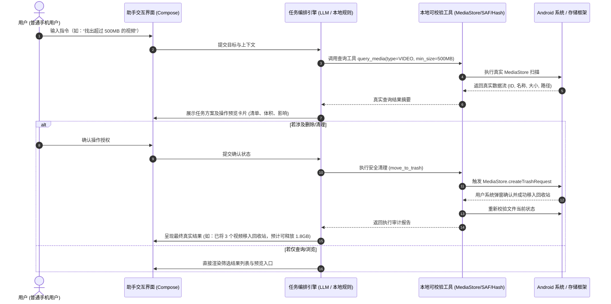

# 产品定义与需求规格说明书 (PRODUCT.md)

---

## 1. 产品概述与定位

本项目是一款面向普通用户的**原生 Android 智能文件与相册管理助手**。
产品采用类似 Codex 的任务编排交互范式：用户通过自然语言提出目标，助手理解意图、查询真实数据或观察屏幕、制定行动步骤、展示操作预览与确认卡片、在用户明确授权下执行操作，并校验与报告真实结果。

### 1.1 核心价值
- **真实数据与操作闭环**：绝不使用预设话术、虚构扫描数量或假进度条冒充功能。所有呈现均对应真实的设备文件与存储状态。
- **真清理存储空间**：专注于分析手机闪存磁盘存储（ROM），帮助用户找出大文件、完全重复文件、旧安装包、过期截图并安全释放空间。**严正声明：本项目不以杀后台应用、释放 RAM 或所谓“一键加速/一键降温”为产品目标。**
- **安全与可控性**：所有破坏性操作（移动、覆盖、删除）均必须生成可校验的具体目标清单并经用户确认。媒体删除优先利用 Android 系统回收站（MediaStore Trash），支持在能力范围内恢复。
- **保护隐私与离线优先**：扫描、统计、哈希查重均在手机本地执行，不默认上传相册或文件；大模型仅接收紧凑的结构化统计与查询摘要。

---

## 2. 核心用户场景与典型交互

### 2.1 典型指令支持
1. **“看看手机里什么最占空间”**：
   - 触发本地存储占用分析，统计图片、视频、音频、文档、安装包及其他文件的真实占比，列出 Top 大文件与清理建议。
2. **“找出超过 500MB 的视频”**：
   - 检索媒体库中大小 $\ge 500\text{MB}$ 的视频列表，按大小降序展示缩略图、文件名、时长与修改日期。
3. **“找出重复照片，让我选择保留哪些”**：
   - 先按文件大小快速粗筛，对同大小候选集计算 SHA-256 完整内容哈希，精确识别完全重复文件；
   - 渲染成组对比卡片，智能建议保留最新或指定路径的文件，待用户确认后执行处理。
4. **“把上个月的截图整理成一个相册”**：
   - 检索指定时间段（如 2026 年 9 月）的 Screenshot 媒体，展示批量预览卡片，支持创建应用内分类相册或安全移动到指定目录。
5. **“找出下载目录里的旧安装包，先让我确认”**：
   - 扫描用户授权目录或 Download 目录中的 `.apk` 文件，解析版本号、生成时间与占用体积，生成确认卡片后供用户决定是否删除。
6. **“帮我打开系统存储管理页面，看看还有哪些可以清理”**：
   - 在用户开启辅助功能并明确指令后，通过屏幕辅助执行器调用系统 Intent 并辅助定位到系统设置中的存储管理页面。

---

## 3. 功能模块规划与界面设计

应用提供五大核心界面（Tab 导航）：

### 3.1 助手 (Assistant)
- **对话流**：消息气泡展示用户需求与助手回复。
- **任务步骤卡片**：展示当前任务的拆解步骤（如：`1. 检索超大视频 (已完成)` $\rightarrow$ `2. 计算占用空间 (已完成)` $\rightarrow$ `3. 等待用户确认 (当前)`）。
- **交互式确认卡片 (Action Preview Card)**：明确列出操作类型、受影响对象列表、文件数量、预计释放大小、可恢复性说明，提供【确认执行】和【取消】按钮。
- **任务状态与停止**：实时显示执行中微调状态，提供全局【停止】入口。

### 3.2 存储分析 (Storage)
- **占用概览图表**：真实反映设备总容量、已用空间、各分类（视频/图片/音频/文档/APK/其他）占用分布。
- **大文件专区**：一键筛选 $>100\text{MB}$、$>500\text{MB}$、$>1\text{GB}$ 文件。
- **完全重复文件专区**：基于内容哈希的分组查看器与一键优化建议。
- **清理建议看板**：截屏清理、临时日志清理、废弃安装包清理等。

### 3.3 文件与相册 (Files & Albums)
- **分类浏览**：相册（相机拍摄、屏幕截图、视频、第三方保存）与文件层级（Download、Documents、用户授权目录）。
- **多维度筛选与排序**：按大小、修改时间、文件类型进行实时过滤。
- **多选与批量操作**：多选条目、批量预览、批量移入回收站、重命名或移动。
- **图片与视频预览器**：高保真缩略图与详情元数据展示（EXIF 信息、路径、分辨率、哈希值）。

### 3.4 操作审计与记录 (Audit Log)
- **历史记录列表**：持久化在本地 Room 数据库中。
- **状态追踪**：成功（Success）、失败（Failed）、取消（Cancelled）、已撤销/已恢复（Restored）。
- **可恢复对象入口**：对于移入回收站的媒体对象，提供便捷入口跳转系统媒体回收站或调用系统还原 API。

### 3.5 设置 (Settings)
- **模型服务配置**：
  - 支持用户配置 OpenAI 兼容协议接口（API Base URL、API Key、Model Name，例如 `gpt-4o-mini`、`deepseek-chat`、`qwen-plus`）。
  - API Key 采用 Android Keystore + 本地加密存储，严禁明文记录。
  - 提供【连接测试】按钮，支持实时诊断网络可用性与模型响应。
- **权限管理看板**：
  - 媒体读取权限（图片/视频）、部分照片选择权限状态；
  - 所有文件管理权限（MANAGE_EXTERNAL_STORAGE，按需申请，带详细引导说明）；
  - 无障碍屏幕操作权限状态与跳转引导。
- **屏幕操作开关**：独立模块开关，默认关闭。只有用户手动开启后才激活辅助能力。
- **隐私与离线偏好**：离线模式强制开关、数据脱敏选项。

---

## 4. 验收标准与交付边界

1. **真实数据**：所有存储容量、文件列表、重复哈希、清理释放量必须通过 Android 系统底层 API 实测，杜绝任何假数据。
2. **安全准则**：
   - 严禁未经用户在确认卡片上点击同意即删除或修改任何文件。
   - 媒体文件优先使用 `MediaStore.createTrashRequest` 机制，区分“移入回收站”与“永久释放”。
   - 移入回收站请求失败时，绝不私自改为物理永久删除。
3. **健壮性**：
   - 面对权限被拒、仅授权部分照片、文件被外部删除、大文件高并发哈希计算时，能够优雅容错、展示友好提示并支持随时取消。
4. **交付物**：
   - 完整可构建的代码工程与 Gradle 构建脚本。
   - 详细的架构与交接文档（`AGENTS.md`, `docs/*`）。
   - 编译产出的 Release/Debug APK，并在基准目标设备（荣耀 VKJ-AN00 / Android 16）或兼容测试机上验证记录。
