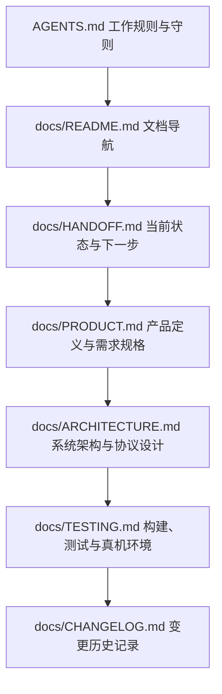

# 文档导航中心 (Documentation Index)

欢迎查阅 **Android 手机任务智能体** 项目文档体系。当前优先跨应用操作（打开应用、搜索内容、完成操作），原生文件与相册能力作为工具保留。为了帮助开发者与 Agent 快速进入角色，本文档提供了系统化的阅读顺序与目录索引。

---

## 1. 推荐阅读顺序

无论您是初次加入的开发者还是接手本任务的 AI Agent，建议遵循以下阅读路径：

1. **`AGENTS.md`**：了解多 Agent 协作工作规范、真实性底线、文档同步强制要求。
2. **`docs/HANDOFF.md`**：了解当前工程处于哪个开发阶段、哪些功能已验证、哪些存在阻塞、下一步具体做什么。
3. **`docs/PRODUCT.md`**：了解产品面向普通用户的核心目标、功能范围、自然语言指令交互形态与非目标（如不杀后台、不虚构清理）。
4. **`docs/ARCHITECTURE.md`**：深入理解四层架构（UI交互层、任务编排与状态层、可校验工具层、数据与模型适配层）、权限演进策略、安全确认卡片设计及 Keystore 密钥管理机制。
5. **`docs/TESTING.md`**：掌握本地构建、单元测试、目标设备（荣耀 VKJ-AN00 / MagicOS 10.0 / Android 16）测试与验证指导。
6. **`docs/CHANGELOG.md`**：按时间顺序查看所有历史修改明细、验证记录与后续问题。

---

## 2. 文档索引与职责划分

| 相对路径 | 核心职责 | 重点更新时机 |
| :--- | :--- | :--- |
| `AGENTS.md` | 开发守则、协作规范、真实性保障 | 团队协作规范演进时更新 |
| `docs/README.md` | 文档总览与推荐导航路径 | 新增重要文档或流程重组时更新 |
| `docs/PRODUCT.md` | 产品定位、交互闭环、核心场景与交付边界 | 用户意图调整、功能范围裁定或验收标准细化时 |
| `docs/ARCHITECTURE.md` | 模块划分、数据流图、Tool 结构化协议、加密与权限方案 | 新增模块、协议演进、技术选型变更时 |
| `docs/HANDOFF.md` | 当前阶段、三态清单（已验/未验/未做）、阻塞项与接手指南 | 每轮编码或验证结束后立即更新 |
| `docs/TESTING.md` | 测试环境信息、构建命令、测试用例、真机验证记录 | 每次执行单元测试、构建 APK 或真机联调后更新 |
| `docs/CHANGELOG.md` | 格式规范的变更日记（Asia/Shanghai，UTC+08:00） | 每次提交或逻辑变更同批追加 |

---

## 3. 项目基本信息

- **目标平台**：Android 11 (API 30) ~ Android 16 (API 36)
- **基准适配机型**：荣耀 VKJ-AN00（MagicOS 10.0 / Android 16 / 12GB RAM / 256GB ROM）
- **开发语言**：Kotlin 2.2+ / Jetpack Compose / Coroutines & Flow
- **架构基础**：Material 3 + Jetpack Compose + 协程 + 原生 `SQLiteOpenHelper`（未引入 Room/WorkManager，详见 `docs/ARCHITECTURE.md` §6 实现现状校准）

> 2026-10-18：当前屏幕执行为无障碍控件树驱动，尚无截图视觉理解。新的 AgentLoop / ScreenSession / AgentConversation 及真实验证结论见 ARCHITECTURE.md §7 与 HANDOFF.md，旧历史记录不代表当前通用能力已通过验收。
